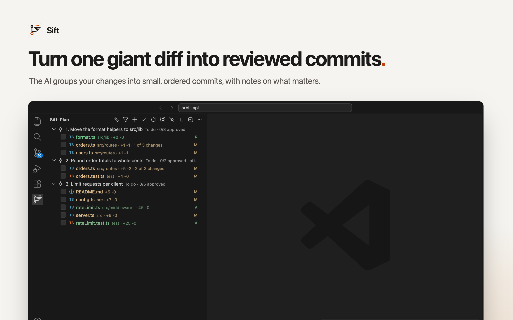
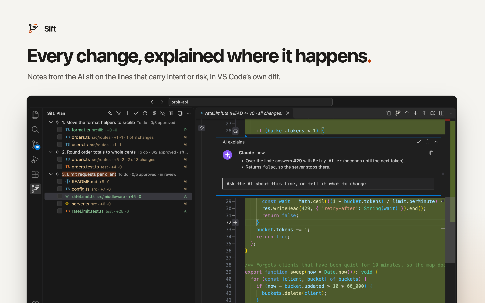
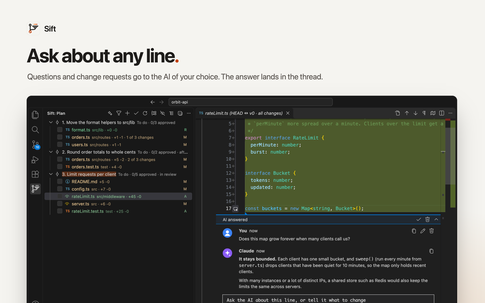
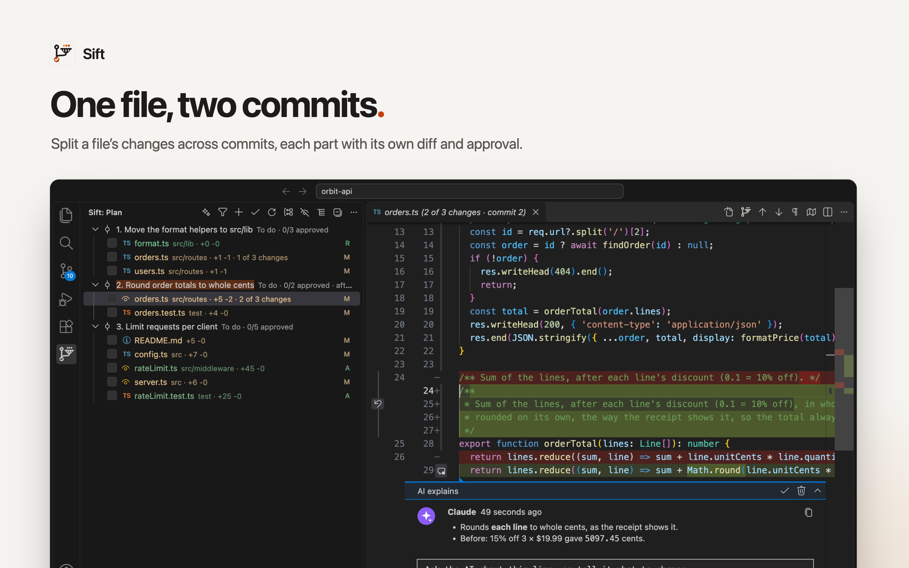
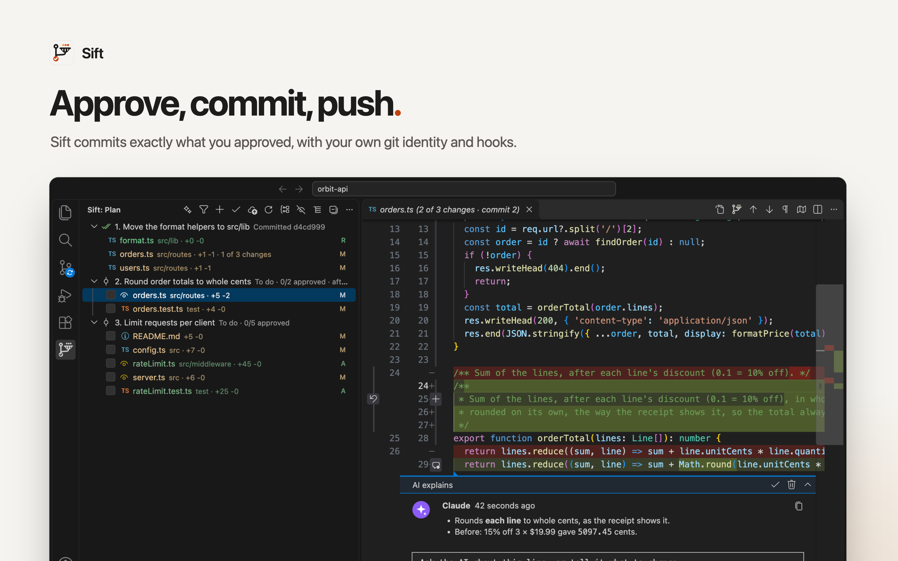

<picture>
  <source media="(prefers-color-scheme: dark)" srcset="resources/logo/sift-paper.png">
  
</picture>

# Sift

**Sift a large change set into reviewed, atomic commits, and ask the AI of your choice about any line.**

When an AI (or you) changes hundreds of files in one go, reviewing a single giant diff doesn't work, and committing it as one blob loses history. Sift asks an AI to split the changes into a plan of atomic commits, with notes on the lines that matter, then walks you through each commit in VS Code's native diff editor. Comment on any line to ask a question or ask for a change, and the answer lands in the same thread. When a commit is right, you approve it and Sift commits exactly those files.


More on the website: [mathsalmi.github.io/sift](https://mathsalmi.github.io/sift/).

## Features

- **AI commit plan:** one click groups every changed file into ordered, atomic commits, with an intent, risk notes and explanations on the lines that matter. Explanations show open on their lines in the diff; **Show / hide AI explanations** in the diff's Sift menu turns them all off and on. Drag files between commits to adjust.
- **Ask about any line:** in a comment, ask a question (the AI answers in the thread) or give a direction (the AI edits the code and says what it changed). Markdown works, **Cmd+Enter** sends, and the thread shows *Thinking…* while the AI works. Edit or delete your own comments. Your comments show your GitHub picture once you allow Sift to use VS Code's GitHub account (Accounts menu).
- **Your choice of AI:** a command line AI (Claude Code, Codex, Gemini CLI) with your own login, any model VS Code offers (GitHub Copilot's GPT, Claude, Gemini, Grok… or other extensions'), or any command you like.
- **Versions per file:** Sift freezes your files in a snapshot when a commit's review starts and after each AI edit, and every file gets its own version numbers: a file goes from v0 to v1 only when a round changed it, so an untouched file stays at v0 while another reaches v7. You can diff:
  - **Latest changes**: the file's previous version ↔ working tree, while the change is unseen.
  - **Changed since approval:** a file you edit after approving it shows only that edit: the approved content ↔ working tree.
  - **All changes:** HEAD ↔ working tree, i.e. what will be committed.
  - **Any of the file's versions ↔ now,** e.g. v1 ↔ working tree.

  Pick one with the **Compare with** dropdown in the diff editor title.
- **Native VS Code:** real diff editor, inline comment threads, go-to-definition and editing inside the diff all keep working.
- **Files as a list or a tree:** switch with the list/tree button in the view title, like the Source Control view. Collapse or expand everything with the button next to it.
- **Locally excluded files:** a **Locally excluded** group at the end of the plan lists the rules in `.git/info/exclude` (except Sift's own `.sift/`). Click a file to open it; **Remove from .git/info/exclude** (eye button or right-click) brings its changes back into the review. Edits to the file by hand show up right away.
- **Group by status:** the group button in the view title splits each commit's files into **To do**, **In progress** and **Approved**. Off by default.
- **Hide approved files:** the eye button in the view title hides files as soon as you approve them, so only what's left to review stays in view. Planned commits stay listed even when all their files are hidden. Approved files are shown by default.
- **Hide committed commits:** in the view title's **…** menu, separate from approved files. Committed commits are shown by default, marked **Committed** (not pushed yet), **Pushed** or **Reverted**.
- **Filter files:** the filter button in the view title narrows the plan to files whose path fuzzy-matches what you type (`ctrl rev` finds `src/controller/ReviewController.ts`). Escape puts the previous filter back; the ✕ button clears it.
- **Commit everything approved:** the ✓ button in the view title commits every approved commit, in plan order, without asking. It asks only when it would commit files you haven't approved: when nothing is approved yet it offers the commit in review. **Commit and push** is in the **…** menu, and **Push** appears once commits wait to be pushed.
- **Dependencies:** a commit can build on earlier ones (**Set the commits it builds on** on a commit, or `dependsOn` from the AI). Sift then never moves it above them or commits it before them; committing it commits them first. Independent approved commits can be committed ahead of unapproved ones.
- **Split a file across commits:** one file's changes can go to different commits; a new file splits by paragraphs. In the diff, select the changed lines and right-click **Move selected changes to commit**, or use **Split changes across commits** (file right-click, or the Sift menu in the diff) to pick changes from a list. The file then shows in each commit with "2 of 5 changes"; each part has its own diff (only its changes), approval and review status, and committing a commit commits only its part. A part whose change you edit keeps it; moving a part onto the commit of another part joins them, and a plan places whole files again.
- **Renames:** a moved or renamed file shows once, marked **R**. Its diff compares it with its old name, and committing or discarding it takes both names along. A plan can list it by either name.
- **Discard changes:** right-click a file, folder or the Sift menu in the diff for **Discard changes**: the file goes back to HEAD (a new file is deleted); for a part of a split file, only that part's changes go. Asks first; it can't be undone.
- **Amend into a commit:** **Amend into commit** on a file, folder or planned commit folds its changes into a commit already made in this review and not pushed yet. Amending an older commit rewrites the ones after it (Sift says which first); if the change conflicts with them, nothing changes.
- **Branch and sync:** the Sift view's title shows the branch and how it stands against its remote branch (`main ↑2 ↓1`, or "not published"). **Pull** appears when the remote branch has new commits. **Push** fetches first and, when the remote branch moved on, offers to pull before pushing instead of failing. Fetch, pull and push go through VS Code's Git, with its sign-in and your pull settings.
- **Undo or revert:** a committed commit not pushed yet has **Undo commit**: its changes (and those of any commit made after it) go back to the working tree and the plan, approvals kept. A pushed commit has **Revert commit**, which makes a new commit that undoes it.
- **Review status:** files are reviewed as part of a commit: unassigned ones have no checkbox until you move them into one. Tick a file's checkbox to approve it. Sift asks first when the file still has unresolved comments. A commit is **To do** until one file is approved, **In progress** while some are, and **Approved** when all are. Files that change after you approved them go back to In progress.
- **You stay in control:** the AI never stages or commits. Only your Approve click commits, with your git identity and hooks.

## Screenshots











## Requirements

- VS Code 1.95 or later
- Git
- An AI, any of:
  - A command line AI: [Claude Code](https://claude.com/claude-code) (its VS Code extension is enough), [Codex](https://github.com/openai/codex) or [Gemini CLI](https://github.com/google-gemini/gemini-cli).
  - A model in VS Code, e.g. from GitHub Copilot Chat.
  - Any command that reads a prompt on stdin and prints the answer, e.g. `llm`.

Sift also works without AI for manual reviews.

## Install

Install **Sift** from the [VS Code Marketplace](https://marketplace.visualstudio.com/items?itemName=msalmi.sift), or search for "Sift" in the Extensions view.

In other editors built on VS Code (Cursor, Windsurf, VSCodium), download `sift-<version>.vsix` from the [latest release](https://github.com/mathsalmi/sift/releases/latest) and run **Extensions: Install from VSIX**.

To build it from source:

```bash
git clone https://github.com/mathsalmi/sift.git
cd sift
npm install
npm run package -- --out sift.vsix
code --install-extension sift.vsix --force
```

Then run **Developer: Reload Window**.

## Quick start

1. Open a repo with uncommitted changes and click the **Sift** icon in the activity bar.
2. Click **Plan commits with AI** (✨). The plan appears in the Sift view, with explanations on the changed lines. When one file holds changes that belong in different commits, the AI splits it across them. To pick another AI, click its name in the status bar.
3. Click a file of the first commit: that commit goes into review. In the diff editor, step through its files with **←** / **→**.
4. On any line, click **+** in the gutter and write a question or a direction:
   - **Ask AI** sends it now; the answer appears in the thread (stop it with ⏹).
   - **Add (ask later)** queues it; ask about all queued comments with ✨ in the editor title (**Cmd+Alt+Enter**).
5. Approve each file: tick its checkbox in the tree, or click **✓** in the diff editor (**Cmd+Alt+D**).
6. When the commit is approved, click ✓ in the view title: every approved commit gets committed. The next commit goes into review.
7. When every commit is done, push.

Safety tip: create a backup branch before a big review: `git branch backup/$(date +%Y%m%d-%H%M)`.

## Choosing the AI

Click the AI's name in the status bar (next to Sift's review progress), or run **Sift: Choose AI**. It lists what is available here and saves your choice in your user settings:

| Provider | How Sift calls it |
| --- | --- |
| **Claude Code** | `claude -p` with read-only tools (`Read`, `Grep`, `Glob`), no MCP servers, and a JSON schema for the answer. Uses the binary bundled with the Claude Code extension, else `claude` from your login shell. |
| **Codex** | `codex exec --sandbox read-only -`, prompt on stdin. |
| **Gemini CLI** | `gemini --output-format json`, prompt on stdin. Run without a terminal, it uses no tool that needs approval, so it reads but doesn't write. |
| **VS Code model** | Any model available in VS Code, e.g. from GitHub Copilot. Sift gives it read-only tools (read a file, search, list files, all inside the repo) so it can look around like the command line AIs. VS Code asks you once to allow Sift to use the model. |
| **Custom command** | Any command, run in your login shell at the repo root. It gets the prompt on stdin and must print an answer containing the JSON. |

For the command line AIs, Choose AI shows which ones it found and then asks for the model (or the tool's default). They use your own login and subscription.

## Chat agents (Copilot agent mode)

Sift also gives VS Code's chat agents, such as GitHub Copilot in agent mode, tools to drive the review from the chat:

| Tool | Reference | What the agent can do |
| --- | --- | --- |
| Read the review | `#siftReview` | See the planned commits, their files and status, and your comments waiting for an answer |
| Set the commit plan | `#siftPlan` | Split the uncommitted changes into commits. Asks you first when it would replace a plan under review |
| Explain a line | `#siftExplain` | Add an explanation on a changed line |
| Answer a comment | `#siftReply` | Reply in a thread after changing the code with its own tools; Sift records the change as a new version |

For example: *"Split my changes into commits with Sift"*, or *"Answer my Sift comments"*. The agent never approves files or commits: that stays your click.

## Coding agents

Sift installs a `sift` skill for the coding agent you use, so asking it *"plan the commits in Sift"* or *"move the tests to their own commit in Sift"* works without explaining what Sift is: the agent reads the changes and the current plan, then writes `.sift/plan.json`.

- By default only the agent chosen with **Choose AI** gets it (Claude Code, Codex or Gemini CLI). Until you choose an AI, no agent gets it, even though Sift uses Claude Code by default. To pick others, list them in `sift.agentSkills` (`claude`, `codex`, `gemini`); an empty list installs it nowhere.
- Each agent gets one file in its own skills folder only: `~/.claude/skills/sift`, `~/.codex/skills/sift` or `~/.gemini/skills/sift`. Nothing goes in your repositories, and an agent that isn't installed gets nothing.
- Sift keeps the skill up to date and removes it from agents you take off the list. An agent installed later gets it the next time the VS Code window is focused. A `sift` skill you wrote yourself is never touched.
- Copilot's agent mode uses Sift's own tools instead (see above).

## Plan file

Sift also picks up `.sift/plan.json` whenever it is written, by hand or by another tool, applies it on its own and then deletes it: the plan lives in Sift from then on. With no session it starts one. The plan replaces the commits not committed yet, but a commit in the plan with the same message, or with most of the same files, stays the same commit: it keeps its review (file statuses, versions, comments) and takes the new message. Sift asks first only when the plan drops a commit you already started reviewing (Ignore deletes the file too). A plan Sift can't load (bad JSON, a file that isn't changed) stays, so it can be fixed.

To change the plan from outside Sift (an agent, a script), write `.sift/plan.json` with every commit not committed yet. Don't edit `.sift/state.json`: Sift reloads it when it changes, but it is Sift's own file and its shape can change.

```json
{
  "commits": [
    {
      "message": "Add snapshot service",
      "intent": "Freeze the working tree per review round without touching the index.",
      "riskNotes": ["Uses a private GIT_INDEX_FILE"],
      "files": ["src/git/SnapshotService.ts", "test/git.test.ts"],
      "explanations": [
        { "path": "src/git/SnapshotService.ts", "line": 42, "body": "Writes the tree with a private index so the staging area is untouched." }
      ]
    }
  ]
}
```

- Every path must be a changed file, listed once. Unlisted files stay in **Unassigned**.
- To split a file's changes across commits, list it in each of them as `{ "path": "src/a.ts", "lines": [[12, 18], 40] }`: 1-based line ranges or single lines of the current file (a deleted block is at the line just above where it was). Each commit gets the blocks of changes its lines touch; a plain path in one of them takes the rest, and with none the rest goes to Unassigned. A part that keeps the same changes in the same commit keeps its review.
- `explanations` are optional; each `path` must be one of the commit's files, `line` is 1-based.
- `dependsOn` is optional: 1-based positions of earlier commits in the plan that this one builds on.
- A new plan replaces commits that aren't committed yet.

## Commands and keys

| Command | Mac | Windows / Linux |
| --- | --- | --- |
| Ask AI about all open comments | Cmd+Alt+Enter | Ctrl+Alt+Enter |
| Approve file | Cmd+Alt+D | Ctrl+Alt+D |
| Mark to do | Cmd+Alt+U | Ctrl+Alt+U |
| Next to do (moves on to the next commit once this one is done) | Cmd+Alt+N | Ctrl+Alt+N |
| Switch between latest and all changes | Cmd+Alt+M | Ctrl+Alt+M |
| Send a comment (Ask AI) | Cmd+Enter | Ctrl+Enter |
| Open the Sift view (also when the sidebar is hidden) | Ctrl+Shift+S | Ctrl+Alt+S |

In the diff editor, Sift's actions are all under one **Sift** button (the Sift icon) in the editor toolbar, shown only on files in the review: Approve / unapprove file · Next to do · Previous / next file in the commit · Compare with (latest changes, all changes, or a specific version) · Ask AI about all open comments · Show / hide AI explanations · Move selected changes to commit · Split changes across commits · Move to commit · Amend into commit · Discard changes.

Right-click a commit for: Approve and commit · Review this commit · Edit message · Move up / down · Amend into commit · Delete. Right-click a file for: Approve / unapprove · Mark in progress / to do · Add to .gitignore · Exclude locally (.git/info/exclude) · Move to commit (lists the other commits, Unassigned and **New commit**; with no other commit it goes straight to naming a new one) · Split changes across commits · Amend into commit · Discard changes. Right-click a folder for the same on every file under it (Add to .gitignore and Exclude locally add one rule for the whole folder, so files added to it later stay hidden too). Right-click a locally excluded file or folder for: Remove from .git/info/exclude. Right-click an editor tab of a review file for **Sift**: Show in Sift sidebar · Approve / unapprove · Mark in progress · Mark to do · Add to .gitignore · Exclude locally · Move to commit · Split changes across commits · Amend into commit · Discard changes.

Also in the Sift view and command palette: Plan commits with AI · Choose AI · Plan commits manually · New commit · Commit approved commits (and push) · Push · Refresh (re-reads git and the saved state) · Group / stop grouping files by status · Hide / show approved files · Remove from .git/info/exclude · View as tree / list · Collapse / expand all · Discard plan.

## Settings

| Setting | Default | Meaning |
| --- | --- | --- |
| `sift.ai.provider` | `claude` | `claude`, `codex`, `gemini`, `vscode` or `custom`. Easiest to set with **Choose AI** |
| `sift.ai.model` | empty | Model in the provider's own terms, e.g. `opus`, `flash`, or a VS Code model id; empty for the provider's default |
| `sift.ai.command` | empty | For `custom`: the command. For a command line AI: its path, when Sift can't find it |
| `sift.ai.additionalDirectories` | `[]` | Folders outside the repo the AI may read, e.g. `~/code` for sibling worktrees (Claude Code, Gemini CLI) |
| `sift.ai.extraArguments` | `[]` | Extra options for the command line AI, e.g. `--allowedTools=WebFetch` for Claude Code. Naming an MCP tool there loads your MCP servers, which makes calls slower |
| `sift.agentSkills` | not set | Agents that get the `sift` skill: `claude`, `codex`, `gemini`. Not set: the one chosen with Choose AI, none before you choose (see [Coding agents](#coding-agents)) |
| `sift.stateLocation` | `repo` | `repo`: `.sift/state.json`, excluded via `.git/info/exclude`. `workspaceStorage`: outside the repo. |
| `sift.snapshotMaxFileSizeMB` | `5` | New files larger than this are left out of snapshots |

## Privacy

- Sift has no telemetry and no server of its own.
- Your diffs, comments and file contents go only to the AI you chose, through its own command line tool or VS Code's language model API, under that AI's terms. Nothing is sent until you ask the AI to plan or to answer a comment.
- Sift's files stay local: the review state (`.sift/state.json`, excluded from git, or VS Code's storage with `sift.stateLocation`) and the `sift` skill in your coding agent's skills folder.
- Your GitHub picture in comments is loaded from GitHub only after you allow Sift to use VS Code's GitHub account.

## How it works

- **Snapshots:** git trees built with a private index (`.git/sift/index`) and kept under `refs/sift/<session>/<commit>/v<N>`. Your real index isn't touched until you approve.
- **AI calls:** Sift sends the prompt (numbered diffs, the file, the thread) to the chosen AI and asks for JSON. Command line AIs run once per request and read-only: a one-shot run cannot ask for permission, so anything else is denied unless you allow it with `sift.ai.additionalDirectories` or `sift.ai.extraArguments`. Settings from earlier versions (`sift.ai.claudeCodeModel`, …) are moved to these on startup. Code changes come back as search/replace edits; Sift applies all of them or none, only inside the repo, then takes a new snapshot so the files the AI changed get a new version and "latest changes" shows exactly what it did.
- **Comments:** stored in the state file and anchored by line text, so they follow code that moves. A thread whose line is gone shows as outdated.
- **State:** `.sift/state.json` holds only your decisions: the plan, file assignments, approvals, comments. What git knows is read from git every time and never saved: which files changed and how, and which planned commits are committed. Each commit Sift makes is recorded in `refs/sift/<session>/<commit>/commit`; nothing is added to commit messages.
- **Commits made outside Sift** (terminal, Source Control view, rebase, squash) are picked up as they happen, and when VS Code starts. A planned commit whose files no longer differ from HEAD is committed, linked to the newest commit that touched them; if no commit touched them they were reverted and the commit leaves the plan. A commit that leaves HEAD's history (`git reset`) goes back to the plan. Commits you created empty are left alone.
- **Approvals** cover the file's content when you approved it. Edit the file afterwards and it goes back to In progress ("changed since approval"), so a commit never includes code you didn't see. Its diff then shows only what changed since you approved it; Sift keeps the approved content in git under `refs/sift/<session>/approved/`.
- **Approve and commit:** catches up with git first. Files you staged yourself show up in the plan like any other change (in Unassigned when new); a commit takes exactly its own files, so anything else you staged stays staged.
- **Discard plan:** after a confirmation, deletes the review state and snapshot refs. Your files and commits are untouched.

## Limitations

- **Splitting works on changed and new text files**: a new file splits by paragraphs (a block runs through the blank lines after it). Deleted, renamed and binary files move whole.
- **Renames** are found the way git finds them: a rename with too many changes shows as a deletion and a new file.
- **AI edits are plain file writes.** Command line AIs (Claude Code, Codex, Gemini CLI) change files themselves, so their edits aren't editor undo steps. Review them with the **Latest changes** diff, whose left side is the version before them, and copy back what you want to keep from there.

## Roadmap

- **Review commits already made:** go through a range of existing commits the same way (a rebase mode), after 1.0.

## Development

```bash
npm install
npm test            # model, git, controller and AI service tests against temp git repos
npm run build       # bundles dist/extension.js
npm run watch       # rebuild on change
npm run package     # typecheck, production build, .vsix
```

Press **F5** in VS Code to run the extension in an Extension Development Host. Press **Cmd+R** there to reload after a rebuild.

```text
src/
  extension.ts            activation, commands, file watchers
  ai/                     AiService (plan, answer threads, apply edits), prompts, providers
  controller/             ReviewController: single owner of state
  core/                   ReviewModel (pure rules), anchors, types
  git/                    GitRunner, changes + commit, SnapshotService
  state/                  StateStore (atomic JSON)
  ui/                     trees, comments, status bar, snapshot URIs
test/                     vitest suites
```

## License

[MIT](LICENSE) © 2026 Matheus Salmi
