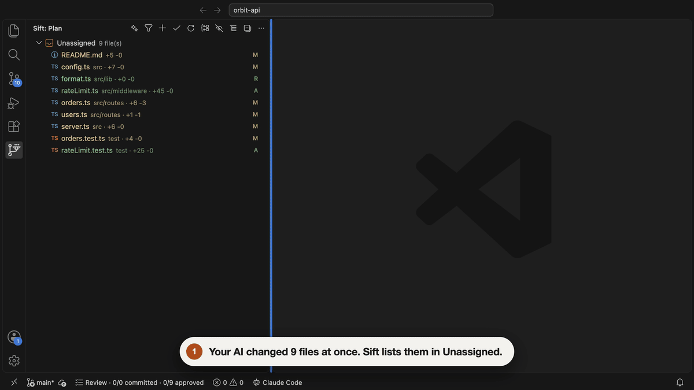

# Sift

**Turn one giant diff into reviewed, atomic commits, with the AI of your choice.**

Sift asks an AI to plan your uncommitted changes into small commits, then walks you through each one in VS Code's own diff editor. Ask about any line, approve, commit.

**[Website](https://msalmi.com/sift/)** · **[Install](https://marketplace.visualstudio.com/items?itemName=msalmi.git-sift)** · **[Releases](https://github.com/mathsalmi/sift/releases)**

## Features

- **Commit plan in one click:** ordered commits with an intent, risk notes and explanations on the lines that matter.
- **Ask about any line:** the AI answers in the comment thread, or edits the code.
- **Any AI:** Claude Code, Codex, Gemini CLI, GitHub Copilot and other VS Code models, or your own command.
- **Split a file across commits,** and see renames as one file.
- **Versions per file:** see only what changed since your last look or your approval.
- **Commit, push, undo, revert and amend** from the Sift view. What you staged stays staged.
- **Agents can drive it too:** Copilot tools, a `sift` skill and a plan file.

## Install

- **VS Code:** install [Git Sift from the Marketplace](https://marketplace.visualstudio.com/items?itemName=msalmi.git-sift).
- **Cursor, Windsurf, VSCodium:** download the `.vsix` from the [latest release](https://github.com/mathsalmi/sift/releases/latest), then run **Extensions: Install from VSIX**.

Needs VS Code 1.95+, Git, and an AI (optional: Sift also works for manual reviews).

## Quick start

1. Open a repo with uncommitted changes and click the **Sift** icon.
2. Click **Plan commits with AI** (✨). The AI groups your changes into commits.
3. Open a file: the AI's notes sit on the lines that matter.
4. Click **+** on a line to ask the AI. The answer lands in the thread.
5. Approve files with their checkbox, then click **✓** to commit.

To change the AI, click its name in the status bar.

## Keys

| Action | Mac | Windows / Linux |
| --- | --- | --- |
| Approve file | Cmd+Alt+D | Ctrl+Alt+D |
| Next to do | Cmd+Alt+N | Ctrl+Alt+N |
| Latest / all changes | Cmd+Alt+M | Ctrl+Alt+M |
| Ask AI about open comments | Cmd+Alt+Enter | Ctrl+Alt+Enter |
| Send a comment | Cmd+Enter | Ctrl+Enter |
| Open Sift | Ctrl+Shift+S | Ctrl+Alt+S |

## Settings

| Setting | What it does |
| --- | --- |
| `sift.ai.provider` | `claude`, `codex`, `gemini`, `vscode` or `custom` |
| `sift.ai.model` | Model to use; empty for the default |
| `sift.ai.command` | The command for `custom`, or the path to a command line AI |
| `sift.ai.additionalDirectories` | Folders outside the repo the AI may read |
| `sift.ai.extraArguments` | Extra options for the command line AI |
| `sift.agentSkills` | Agents that get the `sift` skill |
| `sift.stateLocation` | `repo` (`.sift/state.json`) or `workspaceStorage` |
| `sift.snapshotMaxFileSizeMB` | New files larger than this are left out of snapshots |

## Privacy

No telemetry and no server. Your changes go only to the AI you chose, and only when you ask it to plan or answer.

## Limitations

- Binary and deleted files can't be split across commits.
- AI edits from command line AIs aren't editor undo steps: use the **Latest changes** diff to get earlier text back.

## License

[MIT](LICENSE) © 2026 Matheus Salmi
